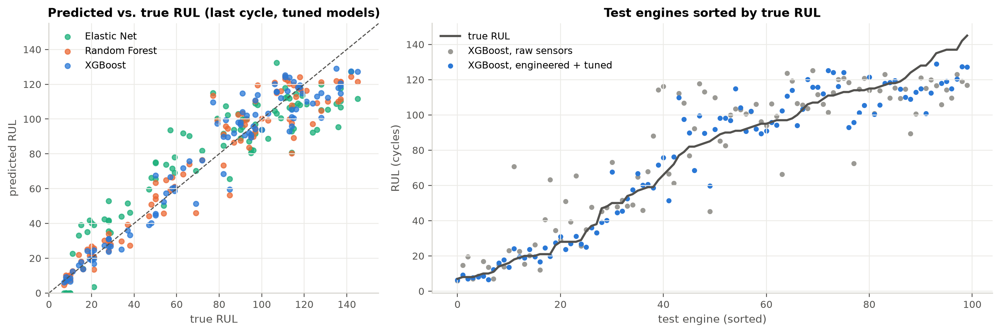
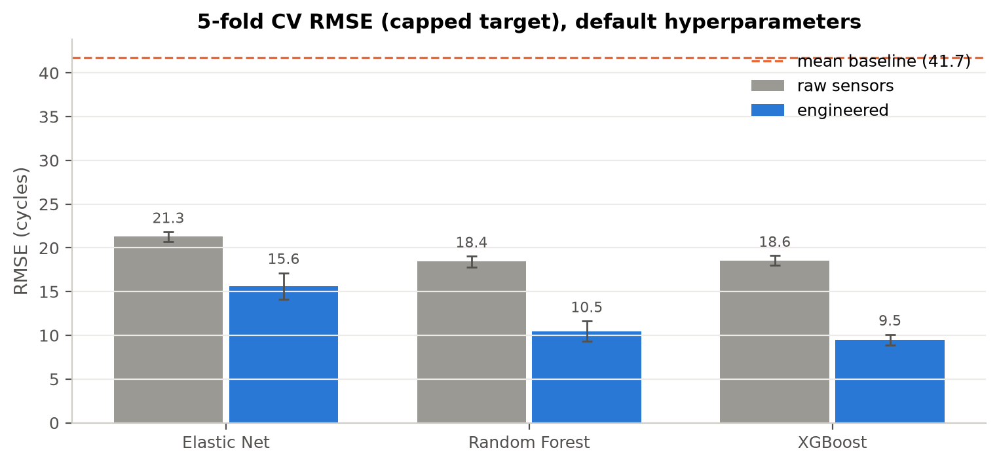
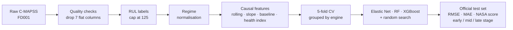
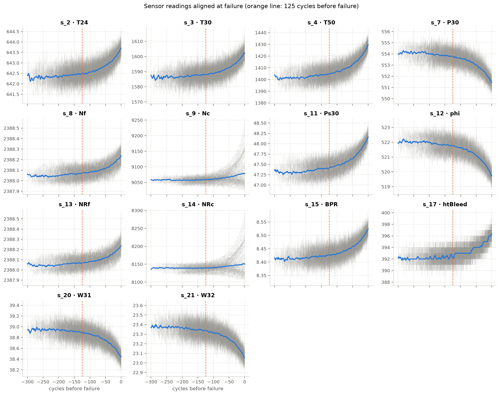

# Remaining Useful Life Prediction for Industrial Engines

**Project 7 · Predictive Maintenance via Sensor Features and Sequence Models**


We predict how many operating cycles a turbofan engine has left before it fails, using the multivariate sensor histories of NASA's C-MAPSS run-to-failure simulation (subset **FD001**). **Phase 1** builds a leakage-free degradation-feature pipeline and compares Elastic Net, Random Forest and XGBoost. **Phase 2** adds engine-aware sequence preparation, an LSTM training pipeline, validation-only ablations, and a final comparison on the official test engines. The evaluated LSTM did not outperform the Phase 1 XGBoost benchmark; this result is reported without post-test tuning.

**Updated IEEE report:** [LaTeX source](report/main.tex) · [compiled PDF (Phases 1 and 2)](report/RUL_Prediction_Phase1_Report.pdf)

---

## Results at a glance

Official FD001 test set, 100 engines, RMSE in cycles at the last observed cycle (lower is better):

| Model | Raw-sensor RMSE | Engineered + tuning RMSE | LSTM RMSE | 95% CI (engineered / LSTM) |
|---|---:|---:|---:|---|
| Mean baseline | 43.07 | – | – | – |
| Elastic Net | 21.90 | 16.78 | – | 14.7 – 18.7 / – |
| Random Forest | 18.07 | 11.91 | – | 9.9 – 13.9 / – |
| **XGBoost** | 18.19 | **10.75** | – | **9.1 – 12.4** / – |
| LSTM (50-cycle window) | – | – | 14.86 | – / 12.4 – 17.4 |

- **Engineered degradation features roughly halve the error** for the tree models.
- On the same 100 official test engines, the LSTM scored RMSE **14.86**, MAE **10.56**, and NASA score **309.96**, versus XGBoost **10.75**, **8.09**, and **161.11**. Lower is better for all three metrics.
- The LSTM validation RMSE was 8.36, but official-test RMSE was 14.86. This validation-to-test gap is a limitation of the single 20-engine validation holdout, not evidence that sequence learning is better.
- **Near failure (RUL ≤ 50)** the final XGBoost model is off by only **5.7 cycles**, with almost no late bias. The raw-sensor model over-estimates the life of failing engines by about 17 cycles.
- The most useful information is how far and how fast each engine has drifted from **its own early-life state** (baseline deviation, health-index slope), not the raw readings.
- For context: published FD001 results include CNN 18.45, LSTM 16.14 and deep CNN 12.61 RMSE (evaluation details differ between papers).

<p align="center">
  
</p>

<p align="center">
  
</p>

### Phase 2 methodology and result

The Phase 2 workflow splits the 100 run-to-failure training engines into 80 fit and 20 validation engines (seed 42) **before** constructing overlapping windows. A `StandardScaler` is fitted on fit-engine sensor rows only and reused unchanged for held-out engines. Windows are chronological, never cross engine boundaries, use a configurable length, repeat the first normalized sensor vector for left padding, and take the target at the final timestep. Training RUL is capped at 125; final test metrics are also reported against the uncapped supplied RUL.

The selected model is a one-layer LSTM (14 inputs, hidden size 32, dropout 0.2) with a fully connected regression head. The sweep compared window lengths 20/30/50, dropout 0/0.2/0.4, and weight decay 0/0.0001. Selection used capped-RUL validation RMSE only. The final model was refit on all 100 training engines for the validation-selected 32 epochs, then evaluated once at the last observed cycle of each of the 100 official test engines.

| Model | Test RMSE | Test MAE | NASA score |
|---|---:|---:|---:|
| Phase 1 tuned XGBoost | **10.754** | **8.085** | **161.109** |
| Phase 2 selected LSTM | 14.857 | 10.559 | 309.965 |

The LSTM's capped-truth test RMSE is 13.412 (uncapped-truth RMSE is 14.857). The difference matters because the model is trained on targets capped at 125, while 11 official test engines have true RUL above 125. No temporal CNN or hybrid model was implemented; the standalone LSTM did not demonstrate an official-test gain, and a post-hoc hybrid comparison on the already-used test set would not be a valid experiment.

Saved validation/test tables, per-engine predictions, training histories, checkpoint, preprocessing parameters, and plots are in [`outputs/results/phase2/`](outputs/results/phase2/), [`models/phase2/`](models/phase2/), and [`outputs/figures/phase2/`](outputs/figures/phase2/).

---

## Pipeline



**Leakage control.** Every feature at cycle *t* uses only cycles 1..*t* of the same engine (checked by a truncation test). Everything fitted (normalisation, PCA health index) is fitted on training engines only, refitted inside each CV fold. Splits are made by engine id, never by row, and the test set is used once.

---

## Notebooks

Run notebooks 01–05 in order for Phase 1. Notebook 06 presents the saved Phase 2 experiment.

| # | Notebook | What it shows | Colab |
|---|---|---|---|
| 01 | [Data loading & quality](notebooks/01_data_loading_and_quality.ipynb) | column dictionary, quality checks, flat sensors, RUL labels | [](https://colab.research.google.com/github/WhiteHacker000/Remaining-Useful-Life-Prediction-for-Industrial-Engines/blob/main/notebooks/01_data_loading_and_quality.ipynb) |
| 02 | [Exploratory analysis](notebooks/02_exploratory_analysis.ipynb) | lifetimes, operating regimes, degradation patterns, sensor ranking, target design | [](https://colab.research.google.com/github/WhiteHacker000/Remaining-Useful-Life-Prediction-for-Industrial-Engines/blob/main/notebooks/02_exploratory_analysis.ipynb) |
| 03 | [Feature engineering](notebooks/03_feature_engineering.ipynb) | regime normalisation (FD002 demo), 88 causal features, health index, leakage test | [](https://colab.research.google.com/github/WhiteHacker000/Remaining-Useful-Life-Prediction-for-Industrial-Engines/blob/main/notebooks/03_feature_engineering.ipynb) |
| 04 | [Model training & validation](notebooks/04_model_training_and_validation.ipynb) | target-cap experiment, raw vs engineered, feature ablation, tuning | [](https://colab.research.google.com/github/WhiteHacker000/Remaining-Useful-Life-Prediction-for-Industrial-Engines/blob/main/notebooks/04_model_training_and_validation.ipynb) |
| 05 | [Test evaluation & error analysis](notebooks/05_test_evaluation_and_error_analysis.ipynb) | official test set, error by degradation stage, SHAP, limitations | [](https://colab.research.google.com/github/WhiteHacker000/Remaining-Useful-Life-Prediction-for-Industrial-Engines/blob/main/notebooks/05_test_evaluation_and_error_analysis.ipynb) |
| 06 | [Phase 2 sequence learning and comparison](notebooks/06_phase2_sequence_learning_and_comparison.ipynb) | engine split, window construction, model, validation ablations, final test comparison and error plots |

Notebooks 01–05 include their own Colab setup. Notebook 06 reads the saved Phase 2 artifacts and expects the repository and FD001 data to be available locally; it does not retrain the model or rerun the official test evaluation.

---

## Key findings

| Question | Answer |
|---|---|
| Cap the RUL target? | **Yes, at 125.** The linear target gives RMSE 23.4 in the last 150 cycles vs. 13.2 with the cap |
| Do engineered features help? | **Yes, a lot.** CV RMSE: XGBoost 18.6 → 9.5, Random Forest 18.4 → 10.5, Elastic Net 21.3 → 15.6 |
| Which features matter? | baseline deviation and cycle (largest loss when removed), slopes, health index |
| Best model? | XGBoost: tuned CV RMSE 9.26 ± 0.50, better than Random Forest on all 5 folds |
| Does tuning matter? | only about 0.2 cycles, against about 9 cycles from feature engineering |
| Did the LSTM improve the official-test benchmark? | **No.** 14.86 RMSE vs. 10.75 for XGBoost; see the validation-to-test gap and target-cap discussion above |
| Was a hybrid model evaluated? | No. A hybrid was not tested after the standalone LSTM failed to beat XGBoost; no post-hoc test-set model selection was done |

<p align="center">
  
  <br><em>The 14 retained sensors of all training engines, aligned at failure.</em>
</p>

---

## Repository structure

```
├── data/                     C-MAPSS FD001 and FD002 text files + data documentation
├── notebooks/                five Phase 1 notebooks and Phase 2 comparison notebook (06)
├── src/                      reusable code imported by every notebook
│   ├── config.py             paths, constants, sensor dictionary
│   ├── data.py               download, loading, RUL labelling
│   ├── features.py           RegimeScaler, FeatureBuilder (causal, fit-on-train-only)
│   ├── models.py             models, engine-level CV, random search
│   ├── evaluation.py         RMSE, MAE, NASA score, stage breakdown, bootstrap CI
│   ├── plotting.py           shared figure style
│   ├── sequence_data.py      train-only scaling, engine splits, sliding windows
│   ├── lstm.py               configurable LSTM regression architecture
│   ├── training.py           reproducible training, early stopping, checkpoints
│   └── experiments.py        engine-holdout LSTM ablations and selection
├── tests/                    label, feature-causality and data-integrity tests (pytest)
├── scripts/                  Phase 1 reproduction and Phase 2 validation/test runners
├── outputs/
│   ├── figures/              all figures used in the notebooks and report
│   └── results/              CV, validation, and official-test tables (csv / json)
├── models/phase2/            selected LSTM checkpoint, history and scaler metadata
├── report/                   IEEE-format report: PDF + LaTeX source (Overleaf-ready)
├── scripts/download_data.py  manual download of all four C-MAPSS subsets
├── docs/                      presentation deck, outline, and viva question bank
└── requirements.txt
```

---

## Running locally

```bash
git clone https://github.com/WhiteHacker000/Remaining-Useful-Life-Prediction-for-Industrial-Engines.git
cd Remaining-Useful-Life-Prediction-for-Industrial-Engines
python -m venv .venv
source .venv/bin/activate          # Windows: .venv\Scripts\activate
pip install -r requirements.txt
jupyter notebook notebooks/
```

- Notebook 04 takes about 10 minutes (hyperparameter search); other Phase 1 notebooks take under a minute.
- Notebook 05 reads the tuned hyperparameters saved by notebook 04.
- Run Phase 2 validation/ablation (does not load official test data): `python -m scripts.run_phase2_validation`
- Reproduce Phase 1 baseline: `python -m scripts.reproduce_phase1_baseline`
- `python -m scripts.evaluate_phase2_test` retrains the selected final LSTM and evaluates the official test set. **The committed test results are the one final evaluation; do not rerun this command for model selection.**
- Tests: `python -m pytest -q` (40 tests)

The committed Phase 2 checkpoint was trained on CPU with Python 3.12.5 and PyTorch 2.15.0. On macOS, XGBoost may also require the OpenMP runtime (`brew install libomp`).

---

## Dataset

NASA C-MAPSS Turbofan Engine Degradation Simulation (Saxena & Goebel, 2008), subset FD001: one operating condition, one fault mode (HPC degradation), 100 training engines run to failure (20,631 rows) and 100 test engines cut off before failure (13,096 rows). See [`data/README.md`](data/README.md) for the source, file format and integrity checks.

## Limitations and next work

- The LSTM was selected from one seeded 20-engine validation holdout and its validation performance did not generalize to the official test population. It underperformed engineered-feature XGBoost on all three reported test metrics.
- FD001 covers one simulated operating regime and one fault mode; generalization to FD002–FD004 and real engines is unverified.
- Only one LSTM architecture and one final random seed were evaluated. No Temporal CNN or hybrid model was retained or evaluated.
- The Phase 2 test-stage table contains one final-cycle row per engine (100 total); it is not directly interchangeable with the Phase 1 all-test-cycles stage table.
- Next work should use repeated engine-level validation and a pre-registered selection protocol before any new official test evaluation, then assess transfer to other subsets.

---

## Presentation and viva

- [Phase 2 presentation deck](docs/phase2_presentation.pptx) · [rebuildable slide source](docs/phase2_presentation.md)
- Install the optional deck builder with `pip install -r requirements-presentation.txt`, then run `python -m scripts.build_phase2_presentation`
- [Viva question bank with implementation-grounded answers](docs/viva_questions.md)

---

## Team

| Member | Enrollment No. | Role |
|---|---|---|
| **Kushal Tyagi** | 2401010249 | Project lead · modelling, validation and tuning · test evaluation and error analysis |
| Nishant Sharma | 2401010302 | Exploratory analysis · feature engineering |
| Anant Lalwani | 2401020086 | Literature review and report · data loading and quality checks |
| Dev Tyagi | 2401010148 | Data set sourcing and documentation |
| Vansh Khod | 2401010493 | Data cleaning and validation tests |

---

## References

1. A. Saxena, K. Goebel, D. Simon, N. Eklund, "Damage propagation modeling for aircraft engine run-to-failure simulation," *Proc. PHM*, 2008.
2. A. Saxena, K. Goebel, "Turbofan Engine Degradation Simulation Data Set," NASA Ames Prognostics Data Repository, 2008.
3. F. O. Heimes, "Recurrent neural networks for remaining useful life estimation," *Proc. PHM*, 2008.
4. J. Coble, J. W. Hines, "Identifying optimal prognostic parameters from data: a genetic algorithms approach," *Annual Conf. PHM Society*, 2009.
5. X. Li, Q. Ding, J.-Q. Sun, "Remaining useful life estimation in prognostics using deep convolution neural networks," *Reliability Engineering & System Safety*, vol. 172, 2018.
6. T. Chen, C. Guestrin, "XGBoost: a scalable tree boosting system," *Proc. KDD*, 2016.
7. S. M. Lundberg, S.-I. Lee, "A unified approach to interpreting model predictions," *NeurIPS*, 2017.
8. S. Hochreiter, J. Schmidhuber, "Long short-term memory," *Neural Computation*, vol. 9, no. 8, 1997.

Full bibliography: [`report/references.bib`](report/references.bib)
