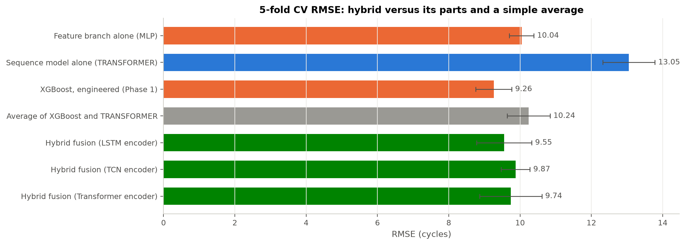
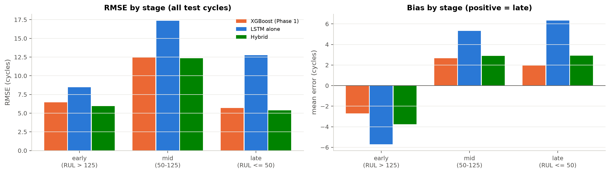
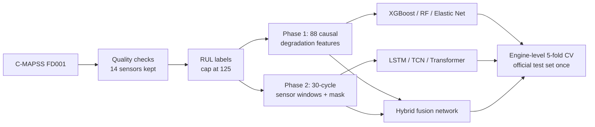

# Remaining Useful Life Prediction for Industrial Engines

**Project 7 · Predictive Maintenance via Sensor Features and Sequence Models**


We predict how many operating cycles a turbofan engine has left before it fails, using the multivariate sensor histories of NASA's C-MAPSS run-to-failure simulation (subset **FD001**).

- **Phase 1 (machine learning):** a leakage-free degradation-feature pipeline with Elastic Net, Random Forest and XGBoost.
- **Phase 2 (deep learning):** LSTM, temporal CNN and Transformer models that learn directly from sensor sequences, and a **hybrid feature-fusion network** that combines sequence learning with the Phase 1 degradation features.

**Reports (IEEE format):** [Phase 1](report/RUL_Prediction_Phase1_Report.pdf) · [Phase 2](report/phase2/RUL_Prediction_Phase2_Report.pdf)

---

## Results at a glance

Official FD001 test set, 100 engines, RMSE in cycles at the last observed cycle (lower is better):

| Model | Input | Test RMSE | 95% CI | MAE |
|---|---|---|---|---|
| XGBoost (Phase 1) | 14 raw sensors, one cycle | 18.19 | 14.9 – 21.2 | 12.93 |
| LSTM (Phase 2) | 30-cycle sensor window | 15.52 | 13.0 – 18.0 | 11.63 |
| Transformer (Phase 2) | 30-cycle sensor window | 15.03 | 12.7 – 17.3 | 11.17 |
| TCN (Phase 2) | 30-cycle sensor window | 14.72 | 12.6 – 16.7 | 11.21 |
| **XGBoost (Phase 1)** | 88 engineered features | **10.75** | 9.1 – 12.4 | 8.09 |
| **Hybrid (Phase 2)** | LSTM on window + 88 features | **11.02** | 9.3 – 12.7 | **8.02** |

**What we found**

- **Sequence models learn real degradation patterns.** On raw sensors they beat single-cycle features by 3 to 3.5 cycles, but on 100 engines they are **significantly worse than engineered features** (paired Wilcoxon, p ≤ 0.002).
- **Why:** the most informative signals, each engine's distance from its own healthy baseline and its age, lie outside any fixed window. Longer windows help a sequence-only LSTM (14.0 → 11.9 CV RMSE at 50 cycles), which confirms the brief's "long trajectories" hypothesis.
- **The hybrid closes the gap.** It beats both its branches and a simple average in cross-validation, and is **statistically level with XGBoost** on the official benchmark (p = 0.90). Over all 13,096 test cycles it has the **lowest error in every degradation stage** (8.54 vs 8.81 RMSE).
- **Ablations:** the engineered features are the backbone (+4.5 RMSE without them). Dropout, input noise and the padding mask help. Early stopping on 7–8 validation engines was too noisy for the hybrid.
- **Saliency:** the sequence branch relies on the core-speed sensors (Nc, NRc) that the hand-made features use least, so the two branches are complementary.

<p align="center">
  
</p>

<p align="center">
  
</p>

---

## Pipeline



**Leakage control.** Features and windows only use past cycles of the same engine (tested). Everything fitted (normalisation, PCA health index) is fitted on training engines only and refitted in every fold. Splits are by engine id, never by row. Early stopping uses separate inner-validation engines, and the test set is used once.

---

## Notebooks

| # | Notebook | What it shows | Owner | Colab |
|---|---|---|---|---|
| 01 | [Data loading & quality](notebooks/01_data_loading_and_quality.ipynb) | column dictionary, quality checks, RUL labels | Anant | [](https://colab.research.google.com/github/WhiteHacker000/Remaining-Useful-Life-Prediction-for-Industrial-Engines/blob/main/notebooks/01_data_loading_and_quality.ipynb) |
| 02 | [Exploratory analysis](notebooks/02_exploratory_analysis.ipynb) | degradation patterns, sensor ranking, target design | Nishant | [](https://colab.research.google.com/github/WhiteHacker000/Remaining-Useful-Life-Prediction-for-Industrial-Engines/blob/main/notebooks/02_exploratory_analysis.ipynb) |
| 03 | [Feature engineering](notebooks/03_feature_engineering.ipynb) | 88 causal degradation features, leakage test | Nishant | [](https://colab.research.google.com/github/WhiteHacker000/Remaining-Useful-Life-Prediction-for-Industrial-Engines/blob/main/notebooks/03_feature_engineering.ipynb) |
| 04 | [Model training & validation](notebooks/04_model_training_and_validation.ipynb) | target cap, raw vs engineered, ablation, tuning | Kushal | [](https://colab.research.google.com/github/WhiteHacker000/Remaining-Useful-Life-Prediction-for-Industrial-Engines/blob/main/notebooks/04_model_training_and_validation.ipynb) |
| 05 | [Test evaluation & error analysis](notebooks/05_test_evaluation_and_error_analysis.ipynb) | official test, stages, SHAP, weak spots | Kushal | [](https://colab.research.google.com/github/WhiteHacker000/Remaining-Useful-Life-Prediction-for-Industrial-Engines/blob/main/notebooks/05_test_evaluation_and_error_analysis.ipynb) |
| 06 | [Sequence data & regularisation](notebooks/06_sequence_data_and_regularisation.ipynb) | windows, padding mask, leakage checks, regularisation plan | Kushal | [](https://colab.research.google.com/github/WhiteHacker000/Remaining-Useful-Life-Prediction-for-Industrial-Engines/blob/main/notebooks/06_sequence_data_and_regularisation.ipynb) |
| 07 | [Sequence models](notebooks/07_sequence_models.ipynb) | LSTM, TCN, Transformer: theory and CV comparison | Anant | [](https://colab.research.google.com/github/WhiteHacker000/Remaining-Useful-Life-Prediction-for-Industrial-Engines/blob/main/notebooks/07_sequence_models.ipynb) |
| 08 | [Hybrid model](notebooks/08_hybrid_model.ipynb) | feature-fusion network vs its parts and late fusion | Nishant | [](https://colab.research.google.com/github/WhiteHacker000/Remaining-Useful-Life-Prediction-for-Industrial-Engines/blob/main/notebooks/08_hybrid_model.ipynb) |
| 09 | [Ablation studies](notebooks/09_ablation_studies.ipynb) | branches, window length, regularisation, mask | Dev | [](https://colab.research.google.com/github/WhiteHacker000/Remaining-Useful-Life-Prediction-for-Industrial-Engines/blob/main/notebooks/09_ablation_studies.ipynb) |
| 10 | [DL test evaluation](notebooks/10_dl_test_evaluation.ipynb) | seeds, bootstrap, significance, stages, saliency | Vansh | [](https://colab.research.google.com/github/WhiteHacker000/Remaining-Useful-Life-Prediction-for-Industrial-Engines/blob/main/notebooks/10_dl_test_evaluation.ipynb) |

On Colab, the first cell clones this repository automatically. Notebooks 07–10 load cached results from `outputs/results/dl/` by default. Set `RETRAIN = True` in a notebook to train from scratch (about an hour for all Phase 2 experiments on a laptop).

---

## Repository structure

```
├── data/                     C-MAPSS FD001 and FD002 text files + data documentation
├── notebooks/                01–05 Phase 1 (ML), 06–10 Phase 2 (DL)
├── src/
│   ├── config.py, data.py    paths, constants, loading, RUL labels
│   ├── features.py           Phase 1: regime normalisation, 88 causal features
│   ├── models.py             Phase 1: Elastic Net / RF / XGBoost, engine-level CV, random search
│   ├── evaluation.py         RMSE, MAE, NASA score, stage breakdown, bootstrap CI
│   ├── sequences.py          Phase 2: windows within engine boundaries, padding mask
│   ├── training.py           Phase 2: training loop, regularisation, CV and final runs
│   ├── dl_models.py          Phase 2: LSTM, TCN and Transformer encoders
│   ├── hybrid.py             Phase 2: hybrid feature-fusion network
│   ├── validation.py         Phase 2: paired Wilcoxon test, gradient saliency
│   └── plotting.py           shared figure style
├── tests/                    labels, feature causality, data integrity, windows, models (pytest)
├── outputs/
│   ├── figures/              all figures used in notebooks, reports and slides
│   ├── results/              Phase 1 tables; results/dl/ Phase 2 experiment results
│   └── models/               trained Phase 2 network weights
├── report/                   Phase 1 report; report/phase2/ Phase 2 report (PDF + LaTeX, one section file per member)
├── scripts/                  data download, Phase 1 XGBoost test predictions
└── requirements.txt
```

---

## Running locally

```bash
git clone https://github.com/WhiteHacker000/Remaining-Useful-Life-Prediction-for-Industrial-Engines.git
cd Remaining-Useful-Life-Prediction-for-Industrial-Engines
python -m venv .venv
source .venv/bin/activate          # Windows: .venv\Scripts\activate
pip install -r requirements.txt
jupyter notebook notebooks/
```

- Run the notebooks in order. Notebook 04 takes about 10 minutes; the Phase 2 notebooks run in minutes from the cached results.
- Tests: `pytest -q`
- macOS note: PyTorch and XGBoost ship different OpenMP runtimes and must not run in the same Python process. The code keeps them apart (see `src/__init__.py`).

---

## Dataset

NASA C-MAPSS Turbofan Engine Degradation Simulation (Saxena & Goebel, 2008), subset FD001: one operating condition, one fault mode (HPC degradation), 100 training engines run to failure (20,631 rows) and 100 test engines cut off before failure (13,096 rows). See [`data/README.md`](data/README.md).

---

## Team

| Member | Enrollment No. | Phase 1 | Phase 2 |
|---|---|---|---|
| Kushal Tyagi | 2401010249 | modelling, validation and tuning · test evaluation | sequence data pipeline · training and regularisation |
| Nishant Sharma | 2401010302 | exploratory analysis · feature engineering | hybrid feature-fusion model |
| Anant Lalwani | 2401020086 | literature review and report · data quality checks | DL literature · LSTM, TCN and Transformer |
| Dev Tyagi | 2401010148 | data set sourcing and documentation | ablation studies |
| Vansh Khod | 2401010493 | data validation tests | test-set validation · significance · saliency |

---

## References

1. A. Saxena, K. Goebel, D. Simon, N. Eklund, "Damage propagation modeling for aircraft engine run-to-failure simulation," *Proc. PHM*, 2008.
2. F. O. Heimes, "Recurrent neural networks for remaining useful life estimation," *Proc. PHM*, 2008.
3. S. Hochreiter, J. Schmidhuber, "Long short-term memory," *Neural Computation*, 1997.
4. S. Bai, J. Z. Kolter, V. Koltun, "An empirical evaluation of generic convolutional and recurrent networks for sequence modeling," arXiv:1803.01271, 2018.
5. A. Vaswani et al., "Attention is all you need," *NeurIPS*, 2017.
6. X. Li, Q. Ding, J.-Q. Sun, "Remaining useful life estimation in prognostics using deep convolution neural networks," *Reliability Engineering & System Safety*, 2018.
7. Z. Chen et al., "Machine remaining useful life prediction via an attention-based deep learning approach," *IEEE Trans. Industrial Electronics*, 2021.
8. N. Srivastava et al., "Dropout: a simple way to prevent neural networks from overfitting," *JMLR*, 2014.
9. T. Chen, C. Guestrin, "XGBoost: a scalable tree boosting system," *Proc. KDD*, 2016.

Full bibliographies: [`report/references.bib`](report/references.bib) · [`report/phase2/references.bib`](report/phase2/references.bib)
