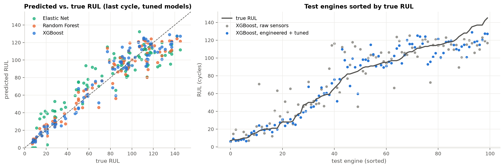
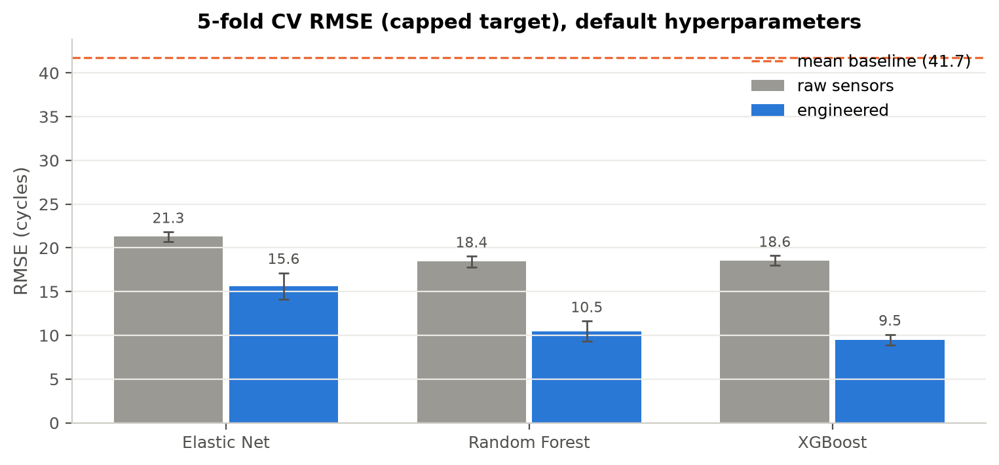
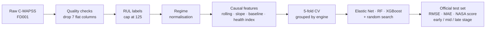
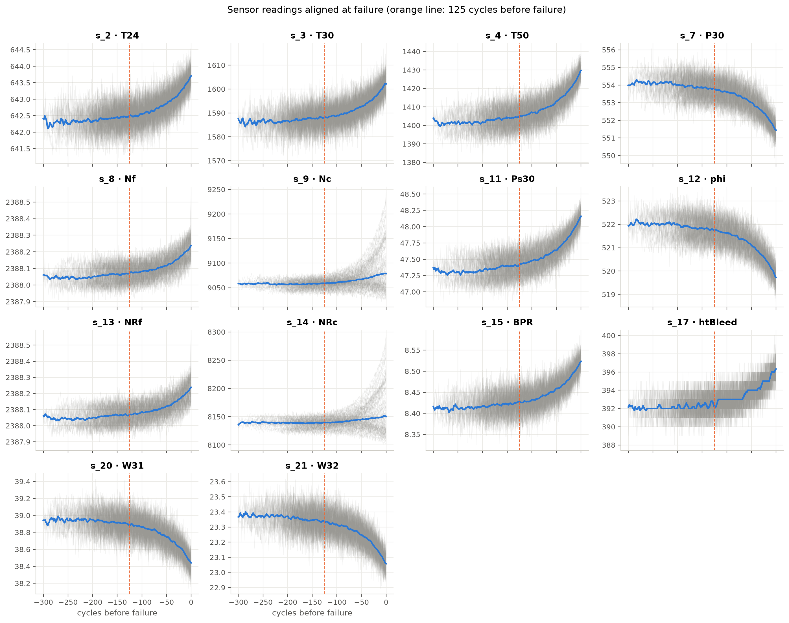

# Remaining Useful Life Prediction for Industrial Engines

**Project 7 · Predictive Maintenance via Sensor Features and Sequence Models**


We predict how many operating cycles a turbofan engine has left before it fails, using the multivariate sensor histories of NASA's C-MAPSS run-to-failure simulation (subset **FD001**). **Phase 1** (this release) builds a leakage-free degradation-feature pipeline and compares Elastic Net, Random Forest and XGBoost. **Phase 2** will compare it with sequence models (LSTM / temporal CNN) that learn directly from raw sensor windows.

**Phase 1 report (IEEE format): [RUL_Prediction_Phase1_Report.pdf](report/RUL_Prediction_Phase1_Report.pdf)**

---

## Results at a glance

Official FD001 test set, 100 engines, RMSE in cycles at the last observed cycle (lower is better):

| Model | Raw sensors | Engineered features + tuning | 95% CI (engineered) |
|---|---|---|---|
| Mean baseline | 43.07 | – | – |
| Elastic Net | 21.90 | 16.78 | 14.7 – 18.7 |
| Random Forest | 18.07 | 11.91 | 9.9 – 13.9 |
| **XGBoost** | 18.19 | **10.75** | **9.1 – 12.4** |

- **Engineered degradation features roughly halve the error** for the tree models.
- **Near failure (RUL ≤ 50)** the final XGBoost model is off by only **5.7 cycles**, with almost no late bias. The raw-sensor model over-estimates the life of failing engines by about 17 cycles.
- The most useful information is how far and how fast each engine has drifted from **its own early-life state** (baseline deviation, health-index slope), not the raw readings.
- For context: published FD001 results include CNN 18.45, LSTM 16.14 and deep CNN 12.61 RMSE (evaluation details differ between papers).

<p align="center">
  
</p>

<p align="center">
  
</p>

---

## Pipeline



**Leakage control.** Every feature at cycle *t* uses only cycles 1..*t* of the same engine (checked by a truncation test). Everything fitted (normalisation, PCA health index) is fitted on training engines only, refitted inside each CV fold. Splits are made by engine id, never by row, and the test set is used once.

---

## Notebooks

Run them in order; each one covers one part of the Phase 1 evaluation.

| # | Notebook | What it shows | Colab |
|---|---|---|---|
| 01 | [Data loading & quality](notebooks/01_data_loading_and_quality.ipynb) | column dictionary, quality checks, flat sensors, RUL labels | [](https://colab.research.google.com/github/WhiteHacker000/Remaining-Useful-Life-Prediction-for-Industrial-Engines/blob/main/notebooks/01_data_loading_and_quality.ipynb) |
| 02 | [Exploratory analysis](notebooks/02_exploratory_analysis.ipynb) | lifetimes, operating regimes, degradation patterns, sensor ranking, target design | [](https://colab.research.google.com/github/WhiteHacker000/Remaining-Useful-Life-Prediction-for-Industrial-Engines/blob/main/notebooks/02_exploratory_analysis.ipynb) |
| 03 | [Feature engineering](notebooks/03_feature_engineering.ipynb) | regime normalisation (FD002 demo), 88 causal features, health index, leakage test | [](https://colab.research.google.com/github/WhiteHacker000/Remaining-Useful-Life-Prediction-for-Industrial-Engines/blob/main/notebooks/03_feature_engineering.ipynb) |
| 04 | [Model training & validation](notebooks/04_model_training_and_validation.ipynb) | target-cap experiment, raw vs engineered, feature ablation, tuning | [](https://colab.research.google.com/github/WhiteHacker000/Remaining-Useful-Life-Prediction-for-Industrial-Engines/blob/main/notebooks/04_model_training_and_validation.ipynb) |
| 05 | [Test evaluation & error analysis](notebooks/05_test_evaluation_and_error_analysis.ipynb) | official test set, error by degradation stage, SHAP, limitations | [](https://colab.research.google.com/github/WhiteHacker000/Remaining-Useful-Life-Prediction-for-Industrial-Engines/blob/main/notebooks/05_test_evaluation_and_error_analysis.ipynb) |

On Colab, the first cell clones this repository automatically, so the notebooks run without any setup.

---

## Key findings

| Question | Answer |
|---|---|
| Cap the RUL target? | **Yes, at 125.** The linear target gives RMSE 23.4 in the last 150 cycles vs. 13.2 with the cap |
| Do engineered features help? | **Yes, a lot.** CV RMSE: XGBoost 18.6 → 9.5, Random Forest 18.4 → 10.5, Elastic Net 21.3 → 15.6 |
| Which features matter? | baseline deviation and cycle (largest loss when removed), slopes, health index |
| Best model? | XGBoost: tuned CV RMSE 9.26 ± 0.50, better than Random Forest on all 5 folds |
| Does tuning matter? | only about 0.2 cycles, against about 9 cycles from feature engineering |
| What is left for Phase 2? | fast-degrading engines, the onset of degradation, short histories: all depend on the full trajectory |

<p align="center">
  
  <br><em>The 14 retained sensors of all training engines, aligned at failure.</em>
</p>

---

## Repository structure

```
├── data/                     C-MAPSS FD001 and FD002 text files + data documentation
├── notebooks/                the five Phase 1 notebooks (01 → 05)
├── src/                      reusable code imported by every notebook
│   ├── config.py             paths, constants, sensor dictionary
│   ├── data.py               download, loading, RUL labelling
│   ├── features.py           RegimeScaler, FeatureBuilder (causal, fit-on-train-only)
│   ├── models.py             models, engine-level CV, random search
│   ├── evaluation.py         RMSE, MAE, NASA score, stage breakdown, bootstrap CI
│   └── plotting.py           shared figure style
├── tests/                    label, feature-causality and data-integrity tests (pytest)
├── outputs/
│   ├── figures/              all figures used in the notebooks and report
│   └── results/              CV and test result tables (csv / json)
├── report/                   IEEE-format report: PDF + LaTeX source (Overleaf-ready)
├── scripts/download_data.py  manual download of all four C-MAPSS subsets
└── requirements.txt
```

---

## Running locally

```bash
git clone https://github.com/WhiteHacker000/Remaining-Useful-Life-Prediction-for-Industrial-Engines.git
cd Remaining-Useful-Life-Prediction-for-Industrial-Engines
python -m venv .venv
source .venv/bin/activate          # Windows: .venv\Scripts\activate
pip install -r requirements.txt
jupyter notebook notebooks/
```

- Notebook 04 takes about 10 minutes (hyperparameter search); the others take under a minute.
- Notebook 05 reads the tuned hyperparameters saved by notebook 04.
- Tests: `pytest -q`

---

## Dataset

NASA C-MAPSS Turbofan Engine Degradation Simulation (Saxena & Goebel, 2008), subset FD001: one operating condition, one fault mode (HPC degradation), 100 training engines run to failure (20,631 rows) and 100 test engines cut off before failure (13,096 rows). See [`data/README.md`](data/README.md) for the source, file format and integrity checks.

---

## Team

| Member | Enrollment No. | Role |
|---|---|---|
| **Kushal Tyagi** | 2401010249 | Project lead · modelling, validation and tuning · test evaluation and error analysis |
| Nishant Sharma | 2401010302 | Exploratory analysis · feature engineering |
| Anant Lalwani | 2401020086 | Literature review and report · data loading and quality checks |
| Dev Tyagi | 2401010148 | Data set sourcing and documentation |
| Vansh Khod | 2401010493 | Data cleaning and validation tests |

---

## References

1. A. Saxena, K. Goebel, D. Simon, N. Eklund, "Damage propagation modeling for aircraft engine run-to-failure simulation," *Proc. PHM*, 2008.
2. A. Saxena, K. Goebel, "Turbofan Engine Degradation Simulation Data Set," NASA Ames Prognostics Data Repository, 2008.
3. F. O. Heimes, "Recurrent neural networks for remaining useful life estimation," *Proc. PHM*, 2008.
4. J. Coble, J. W. Hines, "Identifying optimal prognostic parameters from data: a genetic algorithms approach," *Annual Conf. PHM Society*, 2009.
5. X. Li, Q. Ding, J.-Q. Sun, "Remaining useful life estimation in prognostics using deep convolution neural networks," *Reliability Engineering & System Safety*, vol. 172, 2018.
6. T. Chen, C. Guestrin, "XGBoost: a scalable tree boosting system," *Proc. KDD*, 2016.
7. S. M. Lundberg, S.-I. Lee, "A unified approach to interpreting model predictions," *NeurIPS*, 2017.
8. S. Hochreiter, J. Schmidhuber, "Long short-term memory," *Neural Computation*, vol. 9, no. 8, 1997.

Full bibliography: [`report/references.bib`](report/references.bib)
