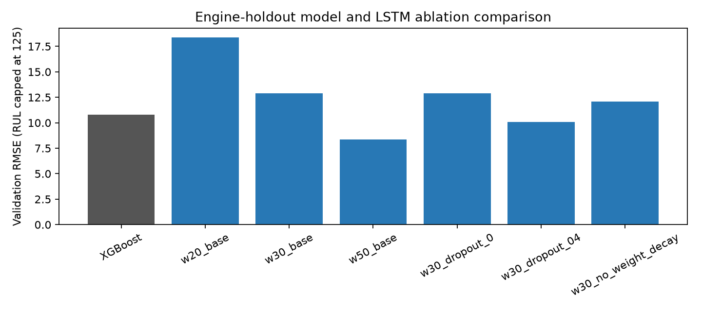
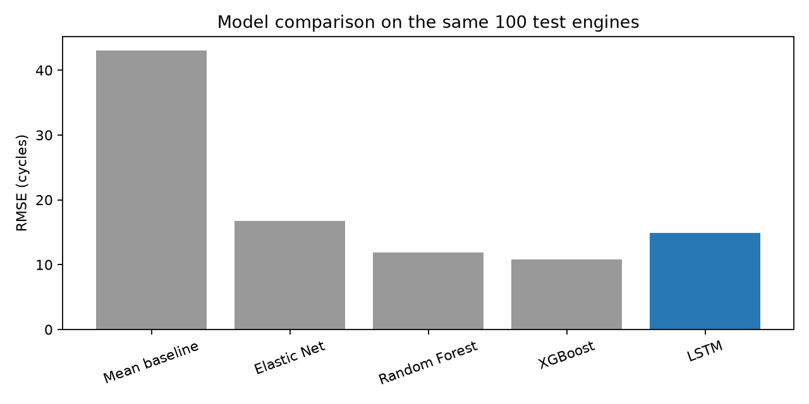
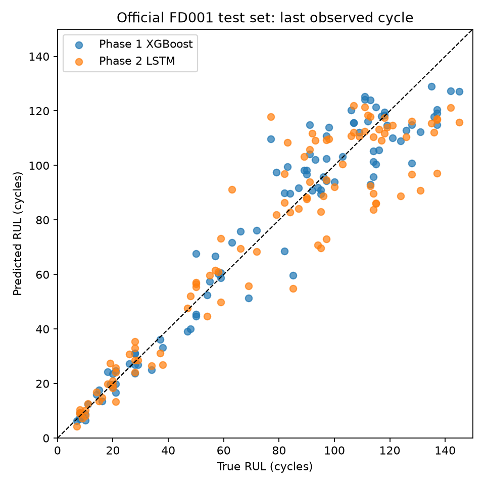

# Project 7 — Predictive Maintenance via Sensor Features and Sequence Models

## Slide 1 — Problem and objective
- Estimate remaining operating cycles before a turbofan engine fails.
- Compare engineered-feature regression with temporal sequence learning.
- Dataset: NASA C-MAPSS FD001, with 100 run-to-failure training engines and 100 official test engines.
- Primary measures: RMSE, MAE, and the asymmetric NASA score; lower is better.

## Slide 2 — Dataset and target
- FD001 represents one operating condition and one high-pressure-compressor fault mode.
- Each cycle contains three settings and 21 sensor values; 14 non-flat sensors are used by the models.
- Training RUL is `min(last_cycle - cycle, 125)`.
- Test RUL at the final observed cycle is supplied by the benchmark; earlier cycle labels can be reconstructed from it.
- The target cap limits the influence of early-life periods with little visible degradation.

## Slide 3 — Phase 1: engineered-feature benchmark
- Causal rolling means, variability, short/long slopes, engine-baseline deviations, cycle count, and a PCA health index.
- Preprocessing is fitted on training engines; features at a cycle use no future rows.
- Five-fold cross-validation is grouped by engine ID.
- Models: Elastic Net, Random Forest, and tuned XGBoost.
- Official FD001 test XGBoost: RMSE 10.754, MAE 8.085, NASA score 161.109.

## Slide 4 — Why evaluate sequence models?
- Hand-selected feature windows can miss longer degradation trajectories and timing differences.
- The LSTM receives chronological sensor windows and learns a temporal representation directly.
- The hypothesis is empirical, not assumed: a more complex model is useful only if it improves the held-out engine evaluation.

## Slide 5 — Leakage-safe Phase 2 data protocol
- Split the 100 training engines into 80 fit and 20 validation engines using seed 42, before window construction.
- Select deterministic pre-failure cutoff cycles for validation engines to emulate censored test histories.
- Fit `StandardScaler` using fit-engine rows only; transform validation and test with those same parameters.
- Build windows independently within each engine; preserve cycle order and endpoint-label alignment.
- Left-pad histories shorter than the window by repeating their first normalized observation.

## Slide 6 — LSTM architecture and training
- Input shape: `(batch, 50 cycles, 14 sensors)`.
- One LSTM layer, hidden size 32, dropout 0.2, and a fully connected regression head.
- AdamW, Huber loss, learning rate 0.001, weight decay 0.0001, batch size 256, seed 42.
- Use validation-only early stopping/checkpoint selection during the sweep; select the 50-cycle configuration by capped-RUL validation RMSE.
- Refit all 100 training engines for the selected 32 epochs, then restore and evaluate the final checkpoint.

## Slide 7 — Validation ablations
- Window 20: RMSE 18.385, MAE 12.993; best epoch 7.
- Window 30, base regularization: RMSE 12.895, MAE 8.911; best epoch 19.
- Window 50, base regularization: RMSE 8.359, MAE 6.521; best epoch 32.
- Window-30 dropout 0.0 / 0.4: RMSE 12.886 / 10.082.
- Window-30 weight decay 0: RMSE 12.090.
- These values are validation results, not final test results.

## Slide 8 — Official test results

| Model | RMSE | MAE | NASA score |
|---|---:|---:|---:|
| Phase 1 tuned XGBoost | **10.754** | **8.085** | **161.109** |
| Phase 2 LSTM | 14.857 | 10.559 | 309.965 |

- Each model predicts once at the last observed cycle of each of the same 100 test engines.
- LSTM RMSE 95% engine-bootstrap interval: 12.353–17.391.
- Against capped RUL, LSTM RMSE is 13.412; against the official uncapped RUL it is 14.857.
- The LSTM did not outperform the baseline; no post-test tuning was performed.

## Slide 9 — Error analysis and interpretation
- Final-cycle stage groups contain 11 early, 56 middle, and 33 late test engines.
- Early (RUL > 125) RMSE: XGBoost 17.59, LSTM 26.31; the cap creates a target mismatch for true RUL above 125.
- Middle (50 < RUL ≤ 125) RMSE: XGBoost 11.50, LSTM 15.69.
- Late (RUL ≤ 50) RMSE: XGBoost 4.79, LSTM 4.52.
- Late-stage result is similar, but the LSTM's overall and early/mid errors are higher.

## Slide 10 — Limitations and next steps
- One validation split and one selected LSTM seed; the strong validation score did not generalize to official test.
- FD001 is simulated, has one operating regime/fault mode, and only 100 test engines.
- No Temporal CNN or hybrid model was implemented; testing a new model on the already-used test set would invalidate the final comparison.
- Future work: repeated engine-level validation, pre-registered selection, then one new untouched evaluation set and transfer to FD002–FD004.

## Slide 11 — Conclusion
- The established benchmark remains the engineered-feature XGBoost model.
- The project now has a reproducible engine-aware LSTM pipeline and measured, documented results.
- The correct conclusion is a negative result for this LSTM configuration: it failed to improve official-test performance.

### References
- A. Saxena and K. Goebel, “Turbofan Engine Degradation Simulation Data Set,” NASA Ames Prognostics Data Repository, 2008.
- S. Hochreiter and J. Schmidhuber, “Long Short-Term Memory,” *Neural Computation*, vol. 9, no. 8, pp. 1735–1780, 1997.
- Detailed bibliography: [`report/references.bib`](../report/references.bib).
